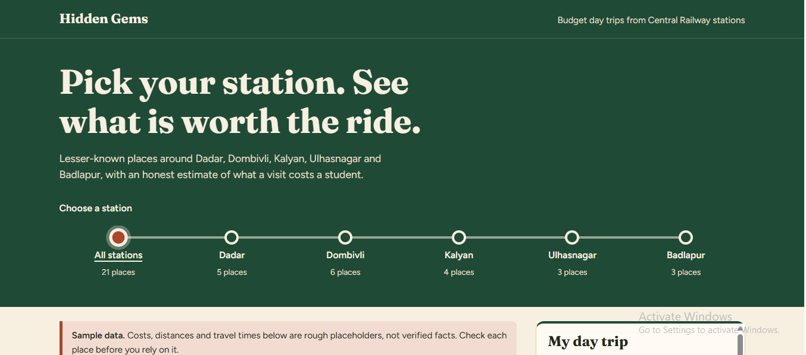
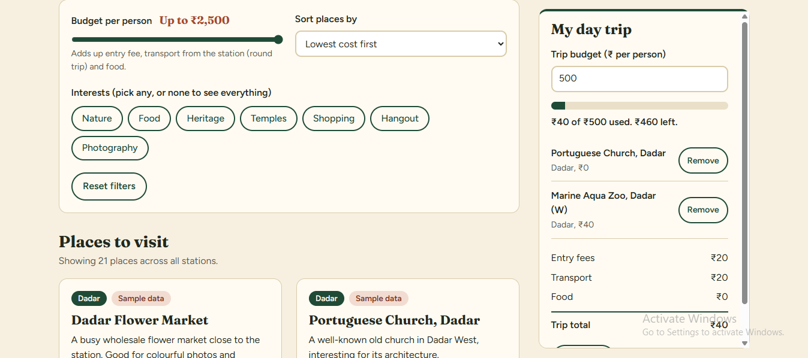

# 🚂 Hidden Gems — Central Railway Day Trip Planner

An interactive web application mapping lesser-known destinations around Central Railway suburban stations (Dadar to Badlapur) paired with a live student budget calculation engine.
A hackathon project designed to help students and budget travellers discover lesser-known destinations around Central Railway stations between Dadar and Badlapur.
Features
- Station-based destination discovery
- Budget and interest-based filtering
- Destination cards with useful travel information

My Contributions

- Defined the project concept and target audience
- Planned the user experience and feature priorities
- Used AI-assisted coding to develop the prototype
  
## 🚀 Live Demo
[👉 Click here to explore Hidden Gems live!](https://priya-bhagat01.github.io/_PS_Hidden_Gems_Project/)

## 📸 Preview

## 🛠️ Key Technical Features
- **Central Line Station Visualizer:** Interactive station navigation bar filtering locations across Dadar, Dombivli, Kalyan, Ulhasnagar, and Badlapur.
- **Dynamic Budget Engine:** Real-time budget calculator ("My Day Trip") aggregating transit fares, entry fees, and food estimates.
- **Multi-Tag Filtering System:** Filter spots across custom interest tags (Nature, Food, Heritage, Temples, Shopping, Hangout) with live cost sorting.

## 🧰 Tech Stack
- **Web Frontend:** HTML5, CSS3 (Custom CSS Grid & Flexbox)
- **Application Logic:** Vanilla JavaScript (ES6 State & Dynamic Array Filtering)

Current Status
Hackathon prototype. Destination information and functionality are being verified.

Future Improvements
- Expand verified destination coverage
- Add community-submitted recommendations
- Introduce persistent saved places and personalised itineraries
